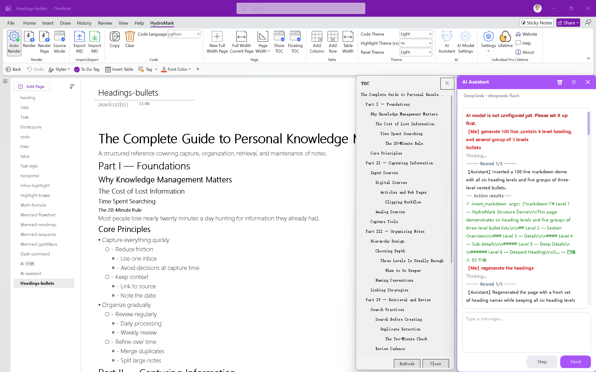

# HydroMark — OneNote-Markdown-Add-in mit KI-Assistent

[English](README.md) · [简体中文](README.zh.md) · [繁體中文](README.zh-TW.md) · [日本語](README.ja.md) · [한국어](README.ko.md) · [Español](README.es.md) · [Português](README.pt.md) · [Русский](README.ru.md) · **Deutsch** · [Français](README.fr.md) · [हिन्दी](README.hi.md) · [العربية](README.ar.md) · [Support](SUPPORT.de.md)

**HydroMark ist ein WYSIWYG-Markdown-Add-in für Microsoft OneNote unter Windows.** Schreiben Sie Markdown auf einer OneNote-Seite — es wird beim Tippen sofort in native OneNote-Inhalte umgewandelt: Überschriften, Listen, Tabellen, Aufgabenlisten, Codeblöcke, LaTeX-Formeln und Mermaid-Diagramme. Kein Export, keine Screenshots, kein Wechsel zwischen Apps. Seit **v1.1.0** schreibt ein integrierter **KI-Assistent** fertig gerenderte Artikel, Tabellen und Seitenoperationen direkt in Ihre Notizen.

> ⚠️ **Dies ist ein Open-Source-Repository, das einen Teil des Codes und der Dokumentation des HydroMark-Projekts enthält.** Außerdem finden hier Produktankündigungen und Community-Feedback (Issues & Discussions) statt. Siehe [Lizenz und Quellcode](#lizenz-und-quellcode) unten.

---

## Was ist HydroMark?

HydroMark ist ein **OneNote-Markdown-Add-in**: ein Windows-Add-in, das einen echten Markdown-Editor direkt in Microsoft OneNote integriert. Sie schreiben weiterhin in den Notizbüchern, auf der Arbeitsfläche und mit der Cloud-Synchronisierung von OneNote, erhalten aber den Markdown-Workflow, den Sie wirklich wollen — tippen Sie `## Heading` und dann die Leertaste, und die Seite zeigt eine gerenderte Überschrift statt roher Syntax.

Alles wird mit **OneNote-eigenen nativen Elementen gerendert, nicht mit Bildern**, daher bleiben Ihre Markdown-Notizen bearbeitbar, in OneNote durchsuchbar, offline verfügbar und werden mit OneNote auf Smartphone, Tablet und im Web synchronisiert. Drücken Sie `F8`, um eine Seite wieder nach `.md` zu exportieren.

Seit **v1.1.0** enthält das Add-in außerdem einen **KI-Assistenten**. Anders als KI-Seitenleisten, die Ihnen Text zum Kopieren liefern, schreibt die KI von HydroMark direkt in die Seite: Sie fügt vollständig gerenderte Artikel ein, erstellt Tabellen und führt Add-in-Aktionen wie Rendern, Exportieren, Inhaltsverzeichnis und Seitenbreite aus — die Ergebnisse werden an das Modell zurückgemeldet, damit es bestätigen oder sich selbst korrigieren kann.

**Für wen es gedacht ist:** Entwickler und technische Teams, Studierende und Forschende, Produkt- und Operations-Teams — alle, die Markdown schreiben, ihre Notizen aber in OneNote behalten.

## Kurzübersicht

| Punkt                    | Detail                                                              |
| ------------------------ | ------------------------------------------------------------------- |
| **Produkt**              | HydroMark — OneNote-Markdown-Add-in mit KI-Assistent                |
| **Kategorie**            | OneNote-Plugin / OneNote-Erweiterung / Office-COM-Add-in            |
| **Plattform**            | Windows 7 und höher                                                 |
| **Host-App**             | OneNote **Desktop** 2013+ (2016 / 2019 / 2021 / Microsoft 365)      |
| **Laufzeitumgebung**     | .NET Framework 4.8+                                                 |
| **Nicht unterstützt**    | OneNote für Windows 10 (UWP / Microsoft Store), macOS, Mobilgeräte  |
| **Testphase**            | 14 Tage voller Funktionsumfang, keine Kreditkarte                   |
| **KI**                   | Integriert — 14 Anbieter, eigener API-Schlüssel                     |
| **Sprachen**             | English · 简体中文 · 繁體中文 · 日本語 · 한국어 · Español · Português · Русский · Deutsch · Français · हिन्दी · العربية |

## ✨ Funktionen

| Funktion                | Was es tut                                                          | Tastenkürzel    |
| ----------------------- | ------------------------------------------------------------------- | --------------- |
| 🤖 **KI-Assistent**     | Schreibt Artikel, Tabellen & führt Add-in-Aktionen direkt auf der Seite aus | `Alt+A`   |
| ✍️ **Rendering beim Tippen** | Überschriften, Listen u. a. formatieren sich beim Schreiben     | `#` / `-` + Leertaste |
| 🔁 **Quelle ↔ gerendert** | Zwischen rohem Markdown und Ergebnis wechseln, pro Seite oder Absatz | —            |
| 📥 **Markdown einfügen** | Verwandelt kopiertes Markdown in eine fertige Notiz                 | `Ctrl+Shift+V`  |
| 💻 **Code-Hervorhebung** | 200+ Sprachen, 100+ Themes, Kopieren mit einem Klick                | —               |
| ∑ **LaTeX-Formeln**     | Formeln inline & als Block als native OneNote-Gleichungen           | `$…$`           |
| 📊 **Diagramme**        | 26+ Mermaid-/ZenUML-Typen: Fluss, Sequenz, Gantt, Mindmap…          | —               |
| ▱ **Tabellen**          | Umschalter volle Breite ↔ inhaltspassend, bleibt erhalten           | `Alt+W`         |
| ☑️ **Aufgabenlisten**   | Klickbare Kästchen, Export als `- [x]` / `- [ ]`                     | —               |
| ⌨️ **Slash-Befehle**    | Befehlspalette zum schnellen Einfügen von Blöcken                    | `/`             |
| 🖍️ **Hervorhebungsblöcke** | Wichtige Notizen optisch hervorheben                           | —               |
| 📑 **TOC & Seitenbreite** | Automatisches Inhaltsverzeichnis; manuelle / automatische Breite  | —               |
| 🌙 **Dark-Mode**        | Inhalt, Dialoge & KI-Seitenleiste folgen OneNote                     | —               |
| 🔄 **Import / Export**  | Markdown-Dateien hinein und heraus (Bilder optional)                | `F8`            |

### 🤖 KI-Assistent — das Highlight (neu in 1.1.0)

Die meisten KI-Seitenleisten liefern eine Textwand zum Kopieren. Der Assistent von HydroMark **schreibt in Ihre Notizen**:

- **Führt Add-in-Aktionen aus, nicht nur Chat** — fügt einen vollständig gerenderten Artikel ein, erstellt Tabellen, führt Seitenoperationen aus (Rendern, Exportieren, Inhaltsverzeichnis, Seitenbreite); Aktionsergebnisse fließen zurück in die Unterhaltung, damit das Modell bestätigen oder sich selbst korrigieren kann.
- **Tabellen auf Befehl, in der gewünschten Breite** — `insert_table` unterstützt Layouts über die volle Seitenbreite und **inhaltspassend**; der KI-Pfad nutzt dieselbe Tabellen-Engine wie der Breitenumschalter `Alt+W`.
- **Eigenes Modell** — 14 integrierte Anbieter (OpenAI, DeepSeek, Kimi, Zhipu, Qwen…), eigene Base-URL für alles andere. Ihr API-Schlüssel bleibt auf Ihrem Rechner; kein Vermittlungsserver.
- **Multimodal** — fügen Sie einen Screenshot in den Chat ein und referenzieren Sie ihn mit multimodalen Modellen.
- **Sprachfolgend** — auf Chinesisch fragen, Chinesisch erhalten; auf Englisch fragen, Englisch erhalten.
- **In jeder Lizenz enthalten** — in der 14-tägigen kostenlosen Testphase und in allen kostenpflichtigen Tarifen. Öffnen mit `Alt+A` oder über die Gruppe **AI** im Menüband.

### 📝 Markdown-Rendering

- **Markdown-Rendering beim Tippen** — `#` oder `-` tippen und dann Leertaste: die Zeile ist sofort formatiert; andere Blöcke weiterhin per Enter oder F5 (WYSIWYG).
- **Doppelansicht: Quelle / gerendert** — jederzeit zwischen rohem Markdown und gerenderter Ausgabe wechseln, pro Seite oder pro Absatz.
- **Markdown von überall einfügen** — `Ctrl+Shift+V` verwandelt einen kopierten Markdown-Block von einer Webseite, einem Dokument oder einer KI-Antwort in eine fertige Notiz.
- **Code-Hervorhebung** — Syntaxhervorhebung für 200+ Sprachen, 100+ Themes, Kopieren mit einem Klick.
- **LaTeX-Formeln** — Inline- und Blockformeln werden als native OneNote-Gleichungen gerendert.
- **Mermaid-/ZenUML-Diagramme** — 26+ Diagrammtypen: Flussdiagramm, Sequenz, Klasse, Zustand, Gantt, Mindmap, UML und mehr.
- **Tabellen mit Umschalter volle Breite ↔ inhaltspassend** — `Alt+W` schaltet jede Tabelle in beide Richtungen um; der Zustand „inhaltspassend“ bleibt erhalten.
- **Aufgabenlisten** — Kontrollkästchen bleiben anklickbar und werden wieder als `- [x]` / `- [ ]` exportiert.
- **Slash-Befehle** — `/` drücken für eine Befehlspalette und Blöcke schnell einfügen.
- **Hervorhebungsblöcke** — wichtige Notizen visuell hervorheben.
- **Seiteninhaltverzeichnis und Seitenbreite** — Inhaltsverzeichnis automatisch erzeugen oder ausblenden; Seitenbreite manuell oder automatisch.
- **Vollständige Dark-Mode-Anpassung** — gerenderte Inhalte, Dialoge und die KI-Seitenleiste folgen dem Theme von OneNote.
- **Nahtloser Import / Export** — Markdown-Dateien rein, Markdown-Dateien raus (Bilder optional).

## 🚀 Erste Schritte

1. **Laden Sie** den einen mehrsprachigen Installer von [https://hydromark.hydrolinx.top/download](https://hydromark.hydrolinx.top/download) herunter (benötigt Windows 7+ und OneNote **Desktop** 2013+).
2. **Führen Sie** den Installer aus — er passt sich automatisch an 32-Bit- und 64-Bit-OneNote an, es gibt kein separates x86-/x64-Paket.
3. **Öffnen Sie OneNote** und finden Sie die Registerkarte **HydroMark** im Menüband.
4. **Schreiben Sie Markdown** — geben Sie `## ` und dann Leertaste für eine Überschrift ein, `- ` und Leertaste für eine Liste; andere Blöcke rendern mit Enter oder `F5`.
5. **Richten Sie zuerst die KI ein** — öffnen Sie **Einstellungen → KI-Modell**, wählen Sie einen Anbieter und geben Sie Ihren API-Schlüssel ein (eigenen Schlüssel mitbringen; 14 Anbieter integriert). Öffnen Sie dann den **KI-Assistenten** mit `Alt+A` (oder der Gruppe **AI** im Menüband) und lassen Sie ihn Artikel und Tabellen direkt auf die Seite schreiben.
6. **Exportieren** Sie die aktuelle Seite mit `F8` nach `.md`.

Eine 14-tägige Testphase mit vollem Funktionsumfang startet automatisch — ohne Kreditkarte. Das vollständige Handbuch finden Sie in der [Dokumentation](https://hydromark.hydrolinx.top/documentation).

## Häufige Fragen

**Gibt es ein Markdown-Add-in für OneNote?**
Ja — HydroMark ist ein Markdown-Add-in, das speziell für Microsoft OneNote Desktop unter Windows entwickelt wurde.

**Kann ich KI nutzen, um Notizen in OneNote zu schreiben?**
Ja. HydroMark enthält einen KI-Assistenten, der gerenderte Markdown-Artikel und Tabellen direkt in die aktuelle OneNote-Seite einfügt und Add-in-Aktionen wie Rendern, Exportieren oder Inhaltsverzeichnis auslösen kann.

**Funktioniert HydroMark mit OneNote für Windows 10, Mac oder Mobilgeräten?**
Nein. HydroMark unterstützt OneNote **Desktop** 2013 und höher (2016 / 2019 / 2021 / Microsoft 365) unter Windows 7+. Die UWP-/Microsoft-Store-Version von OneNote, macOS und Mobilgeräte werden **nicht** unterstützt.

**Ist HydroMark ein OneNote-Plugin oder eine separate App?**
Es ist ein OneNote-Add-in, keine separate Notiz-App. Es installiert sich in OneNote und fügt dem Menüband eine Registerkarte **HydroMark** hinzu; Ihre Notizen bleiben in Ihren bestehenden Notizbüchern.

**Bleiben Markdown-Inhalte in OneNote nativ?**
Ja. Das Rendering verwendet native Elemente von OneNote statt Bilder, sodass Notizen bearbeitbar, durchsuchbar und über alle OneNote-Clients hinweg synchronisierbar bleiben. Seiten können weiterhin nach `.md` exportiert werden.

**Wie installiere ich es?**
Laden Sie den einen mehrsprachigen Installer von der Website herunter, führen Sie ihn aus und öffnen Sie OneNote — im Menüband erscheint eine Registerkarte **HydroMark**. Der Installer passt sich automatisch an 32-Bit- und 64-Bit-OneNote an.

**Ist es kostenlos?**
Es gibt eine 14-tägige Testphase mit vollem Funktionsumfang. Danach werden Lizenzen pro Gerät vergeben (E-Mail + Key): Tarife Individual und Family, Basic und Pro, lebenslang oder jährlich.

## 🌐 Offizielle Links

- Website (English): https://hydromark.hydrolinx.top
- Website (中文): https://hydromark.hydrolinx.cn
- Download: https://hydromark.hydrolinx.top/download
- Dokumentation: https://hydromark.hydrolinx.top/documentation
- Preise: https://hydromark.hydrolinx.top/pricing
- Changelog: https://hydromark.hydrolinx.top/changelog

## 💬 Feedback & Support

Hier erreichen Sie uns am besten:

- 🐛 **Fehlerberichte & Funktionswünsche** → ein [Issue](../../issues) öffnen
- 💡 **Ideen & allgemeine Diskussionen** → [Discussions](../../discussions) nutzen
- 📧 **E-Mail** → support@hydrolinx.top
- 📖 **Support-Leitfaden** → [SUPPORT.de.md](SUPPORT.de.md)

Bitte suchen Sie vor dem Öffnen eines Issues nach bestehenden, um Duplikate zu vermeiden, und geben Sie Ihre Windows-/OneNote-Version sowie Schritte zur Reproduktion an.

## 🗺️ Roadmap

Wir verbessern HydroMark aktiv. Kurzfristig:

- Intelligentere KI-Aktionen — intelligente Zusammenfassungen, automatische Tags und weitere Add-in-Operationen, die der Assistent ausführen kann
- Mehr Diagrammtypen und Blockvorlagen
- Tiefergehende OneNote-Integration

Folgen Sie der Seite [Releases](../../releases) für Update-Hinweise.

## Lizenz und Quellcode

Dies ist ein **Open-Source-Repository**. Es enthält einen Teil des Quellcodes und der Dokumentation des HydroMark-Projekts; der restliche Teil des Projekts liegt nicht in diesem Repository.

Folgendes ist willkommen:

- Den Code und die Dokumentation in diesem Repository lesen, studieren und wiederverwenden
- Issues erstellen und an Diskussionen teilnehmen, um uns zu verbessern
- Den Namen HydroMark verwenden, wenn Sie das Projekt vorstellen oder rezensieren

Bitte verwenden Sie den Namen und die Marke HydroMark nicht in abgeleiteten Produkten oder Diensten, damit Nutzer nicht über die Herkunft getäuscht werden.

© HydroLinx. HydroMark und das Logo sind Marken von HydroLinx.

---

*HydroMark — Markdown, so wie OneNote es hätte haben sollen. Jetzt mit einem KI-Assistenten, der das Tippen übernimmt.*
